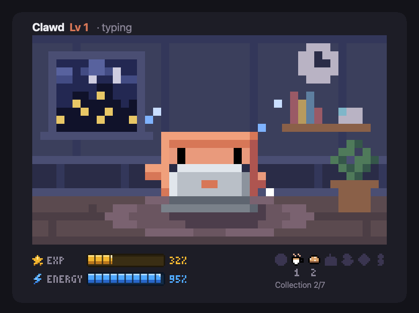

# CC Mods

A catalog of [Claude Code mods](https://code.claude.com/docs/en/plugins/mods/overview) by Steven Ferdianto. The repo is also a plugin marketplace (`stevefrdnt`), so you can install any mod in it straight from Claude Code.

## Catalog

| Mod | What it does | Version | Status |
| --- | --- | --- | --- |
| [**Usage Bars**](mods/usage-bars) | Live progress bars above the prompt for your 5-hour and weekly plan usage, the context left before auto-compact, and this session's tokens and cost | 0.1.0 | In use |
| [**Tokengotchi**](mods/tokengotchi) | Clawd in a pixel office pane: it types on a laptop while Claude works, levels up from your tokens, collects items from finished work, and shows your 5-hour limit as energy | 0.1.0 | New |

### Usage Bars


Four meters sit above the prompt. **5h usage** and **Weekly usage** go green, then orange from 75%, then red from 91%. **Context** shows how full the window is. **Session tokens** shows tokens in, tokens out, and cost. See the [Usage Bars README](mods/usage-bars/README.md) for details, requirements and how to customize it.

### Tokengotchi



▶ [Watch the 30-second showcase](mods/tokengotchi/docs/demo.mp4)

Clawd, the Claude Code mascot, lives in a little pixel office in a pane. While Claude works, Clawd opens a laptop and types. Tokens give it EXP and levels, finished work drops items into a collection, and its energy bar is what's left of your 5-hour plan limit. One pet is shared by all your sessions, and there's nothing to look after. See the [Tokengotchi README](mods/tokengotchi/README.md).

## Install

Add the marketplace once:

```bash
claude plugin marketplace add stevefrdnt/cc-mods
```

Then install any mod from the catalog:

```bash
claude plugin install usage-bars@stevefrdnt
```

To update, run `claude plugin marketplace update stevefrdnt`, then `claude plugin update usage-bars@stevefrdnt`.

To try a mod without installing it, clone the repo and point Claude Code at the mod's folder. Pointing `--plugin-dir` at `mods/` loads every mod in the catalog:

```bash
git clone https://github.com/stevefrdnt/cc-mods.git
claude --plugin-dir ./cc-mods/mods/usage-bars   # one mod
claude --plugin-dir ./cc-mods/mods              # every mod
```

## Repo layout

```
.claude-plugin/marketplace.json   lists every mod, so the repo works as a marketplace
mods/<mod-name>/                  one folder per mod, each a self-contained plugin
```

## Adding a new mod

1. Create `mods/<mod-name>/` with its own `.claude-plugin/plugin.json`, `hooks/`, `README.md` and tests.
2. Add an entry to `.claude-plugin/marketplace.json` with `"source": "./mods/<mod-name>"`.
3. Add a row to the catalog table above.
4. Check it with `claude plugin validate --strict .` at the repo root and inside the mod's folder.

## License

[MIT](LICENSE). These are community mods, not affiliated with or endorsed by Anthropic.
