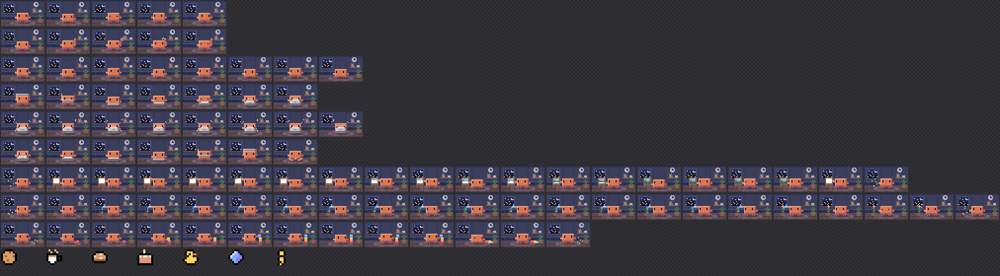

# Tokengotchi

**Clawd, the Claude Code mascot, lives in a tiny pixel office beside your conversation, and gets to work whenever Claude does.**

A [Claude Code mod](https://code.claude.com/docs/en/plugins/mods/overview) that gamifies your sessions, inspired by the pocket pets of the '90s. Your tokens earn Clawd EXP and levels, finished work drops collectible items, and Clawd's energy bar is what's left of your 5-hour plan limit. There's nothing to feed or look after: Clawd never gets hungry or sad, it just reflects how you use Claude Code.


▶ [Watch the 30-second showcase](docs/demo.mp4)

```bash
claude plugin marketplace add stevefrdnt/cc-mods
claude plugin install tokengotchi@stevefrdnt
```

## What Clawd does

| When you… | Clawd… |
| --- | --- |
| Start a session, resume one, or `/clear` | Hops and waves hello |
| Wait at the prompt | Wanders the rug, crab-walking sideways, stopping to breathe, blink and look around |
| Send a prompt | Picks something to work at and sets it up right where it's standing |
| Wait for Claude | Works away at it, until Claude is done |
| Get Claude's answer | Puts its work away and walks back to the middle. About a third of the time, it finds an item |

Each turn, Clawd picks one of four things to do, at random and never the same twice in a row. The pane's header says which:

| Work | What you see |
| --- | --- |
| **Typing** | A laptop comes down from overhead and opens. Clawd types: keys spark, and code bits drift up off the screen |
| **Painting** | An easel appears. Clawd paints a landscape stroke by stroke (sky, sun, hills), steps back to admire it, and puts up a fresh canvas |
| **Gardening** | A potted sprout appears. Clawd waters it, and it grows stage by stage into a pink flower |
| **Building** | Clawd stacks toy blocks into a tower, which wobbles, topples over, and gets built again |

## Levels, energy and the collection

Below the office, the pane shows two bars and the collection:

| | What it shows |
| --- | --- |
| **EXP** | How far Clawd is through its current level. Each turn earns EXP from the tokens it used. The EXP is log-scaled and capped at 40 a turn, so long agent runs don't level Clawd absurdly fast. A subagent's work counts for half |
| **Energy** | What's left of your 5-hour plan limit: 5% used shows 95%. It refills when the window resets, and its frame blinks red at 25% or below. When it's nearly empty, Clawd rests |
| **Collection** | All seven items that finished work can drop, the ones you haven't found yet shown as dark silhouettes, with how many of each you have |

The items, by rarity:

| Item | Rarity |
| --- | --- |
| Bit Cookie, Token Tea, Byte Bun | Common |
| Cache Cake, Rubber Duck | Uncommon |
| Context Crystal | Rare |
| Golden Semicolon | Legendary |

A toast pops up when Clawd finds something or levels up. Subagents earn EXP but never drop items, so a swarm of agents can't farm the collection.

## Commands

| Command | What it does |
| --- | --- |
| `/pet` | Opens Clawd's pane |
| `/pet stats` | Level, EXP, energy, and how much work Clawd has seen |
| `/pet collection` | What you've collected so far |
| `/pet rename <name>` | Gives your pet a new name |
| `/pet reset confirm` | Starts over with a new pet, level 0 and an empty collection |

## Install

From your shell:

```bash
claude plugin marketplace add stevefrdnt/cc-mods
claude plugin install tokengotchi@stevefrdnt
```

Or in one step from inside a Claude Code session:

```
/plugin install tokengotchi --marketplace stevefrdnt/cc-mods
```

The pane opens by itself when a session starts, on terminals wide enough to dock it beside the conversation (about 144 columns). On a narrower one, run `/pet`.

To try it without installing:

```bash
git clone https://github.com/stevefrdnt/cc-mods.git
claude --plugin-dir ./cc-mods/mods/tokengotchi
```

To update or remove it:

```bash
claude plugin update tokengotchi@stevefrdnt
claude plugin uninstall tokengotchi@stevefrdnt
```

### Requirements

- **Claude Code v2.1.287 or later**, which is when mods first shipped. Tokengotchi was built and tested on v2.1.302. Check yours with `claude --version`.
- **A Claude subscription** for the Energy bar. With an API key there's no 5-hour plan limit, so Energy shows as unknown. Everything else works either way.
- **Mods allowed to run:** not in `--safe-mode` or `--bare`, and not blocked by `disableAllHooks` or your organization's managed settings.

## Settings

Set these when you install, or later from the config menu:

| Setting | Default | What it does |
| --- | --- | --- |
| Pet name | `Clawd` | The name a new pet starts with |
| Open the pane on start | on | Opens the pane when a session starts |
| Status line | on | Shows the pet's name, level and whether it's working under the prompt |
| Toasts | on | Pops up a toast when the pet finds an item or levels up |

## How it works

- **One pet for all your sessions.** The pet is saved in the mod's own store, shared by every Claude Code session on your machine. Each session writes only its own log of what happened, and the pet is worked out from a saved snapshot plus every session's log, in time order. Two sessions open at once never overwrite each other's progress.
- **Fair drops.** Each turn's drop is seeded by the turn itself, so it always rolls the same and can't be re-rolled.
- **Energy from Claude Code's own figures**, the same 5-hour limit the status line reads. Readings arrive with Claude's replies, so a new session shows the last one until its first reply.
- **Private.** Only counts and timestamps are stored. The mod never records your prompts or Claude's answers, and it sends nothing over the network. `/pet reset confirm` wipes it.
- **Both surfaces.** In the desktop app, the office is a single animated SVG. In the terminal, it's a 44 × 13 grid of half-block characters, two pixels to a cell, repainted in place about 25 times a second.

## The pixel art

Clawd is drawn on the exact silhouette of the sprite on the Claude Code welcome screen, with each of its quarter-block rows doubled so the pixels come out square. Then it's given volume:

- **Light and shade.** The light comes from the office window, up and to the left. Clawd's top face and left side catch it, and its right side falls into shade, so it reads as a box rather than a flat sticker. Highlights are warmer and shades cooler, not just lighter and darker.
- **Shadows.** Clawd and its props cast soft shadows on the floor. The shadows darken whatever is underneath, rug or planks.
- **Motion.** Key poses are held two or three times longer than the in-betweens, so motion eases in and out. When Clawd walks, it moves a pixel only as a leg pair lands, so its feet never slide.
- **The office.** A night-city window with clouds drifting across it, a clock, a shelf, a plant and a rug, all in muted colors so Clawd's orange stands out.

There are 95 frames in all. The office scene is 44 × 26 pixels, Clawd's frames are 32 × 16 (room on each side for an easel, a plant or a tower of blocks), and the item icons are 8 × 8.



## Development

```bash
claude plugin validate --strict .                      # check the manifest and what the mod hooks and calls
claude plugin test                                     # run the tests in tests/
node scripts/draw-frames.mjs                           # redraw Clawd's frames into hooks/sprites.js
node scripts/preview-sprites.mjs                       # check every grid, write docs/sprites/sheet.png
node scripts/render-demo.mjs | swift scripts/encode-video.swift docs/demo.mp4   # re-render the showcase video (macOS)
```

The tests run with no session, sign-in or network. To work on the mod live, start Claude Code with `claude --plugin-dir ./mods/tokengotchi`. Claude Code reloads the mod whenever you save.

The frames are drawn in code by [`scripts/draw-frames.mjs`](scripts/draw-frames.mjs), so change them there rather than editing `hooks/sprites.js` by hand. Which frames play when, and for how long, is in [`hooks/animation.js`](hooks/animation.js). [PLAN.md](PLAN.md) has the original design notes.

```
.claude-plugin/plugin.json        the manifest and its settings
hooks/hooks.json                  points Claude Code at the mod's code
hooks/register.js                 the mod: events, commands, the pane
hooks/pet.js                      EXP, levels, drops, energy, merging sessions
hooks/animation.js                which frames play when, and for how long
hooks/render.js                   draws a scene as terminal cells or SVG
hooks/hud.js                      the pixel-art bars and the collection strip
hooks/sprites.js                  the frames, the office and the item icons
types/index.d.ts                  the state the pane draws from
tests/tokengotchi.test.ts         tests for claude plugin test
scripts/draw-frames.mjs           draws Clawd's frames
scripts/preview-sprites.mjs       checks the sprites, renders the sheet
scripts/render-demo.mjs           renders the showcase video's frames
scripts/encode-video.swift        captions and encodes them to MP4 (macOS)
```

## License

[MIT](LICENSE)

Tokengotchi is a community mod and isn't affiliated with or endorsed by Anthropic. Clawd is Anthropic's Claude Code mascot, drawn here as fan art.
