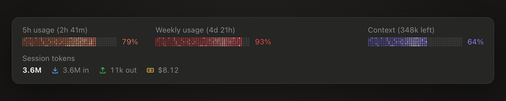

# Usage Bars

A [Claude Code mod](https://code.claude.com/docs/en/plugins/mods/overview) that keeps your plan limits, context window and session tokens in view, as live progress bars right above the prompt.



▶ [Watch the 10-second demo](docs/demo.mp4)

## What it shows

| Meter | What it measures |
| --- | --- |
| **5h usage** | How much of your plan's 5-hour limit you've used, and when it resets |
| **Weekly usage** | How much of your plan's weekly limit you've used, and when it resets |
| **Context** | How full the context window is, and how many tokens are left before auto-compact (or before the window is full, when auto-compact is off) |
| **Session tokens** | Tokens this session has spent (in and out) and what it has cost |

The plan bars change color as you get closer to the limit:

| Used | Color |
| --- | --- |
| 0–74% | Green, with a soft glow |
| 75–90% | Claude orange |
| 91–100% | Red |

The context bar is purple and turns red from 91%. A slow shimmer runs through the filled part of each bar.

In the desktop app the bars are drawn as a grid of tiny squares; in the terminal they're a row of small colored squares.

## Requirements

- **Claude Code v2.1.287 or later.** Mods first shipped in that version. Usage Bars was built and tested on v2.1.289. Check yours with `claude --version`.
- **A Claude subscription** (Pro, Max, Team or Enterprise) for the 5h and weekly bars. With an API key there are no plan limits to show, so those bars stay empty. Context and session tokens work either way.
- Mods must be allowed to run: not in `--safe-mode` or `--bare`, and not blocked by `disableAllHooks` or your organization's managed settings.

## Install

From your shell:

```bash
claude plugin marketplace add stevefrdnt/cc-mods
claude plugin install usage-bars@stevefrdnt
```

Or in one step from inside a Claude Code session (v2.1.275 or later):

```
/plugin install usage-bars --marketplace stevefrdnt/cc-mods
```

The bars appear above the prompt in your next session and fill in after Claude's first reply.

### Try it without installing

```bash
git clone https://github.com/stevefrdnt/cc-mods.git
claude --plugin-dir ./cc-mods/mods/usage-bars
```

### Update

```bash
claude plugin update usage-bars@stevefrdnt
```

### Turn it off

Run `/plugin`, find **usage-bars** on the **Installed** tab and turn it off, or uninstall it with `claude plugin uninstall usage-bars@stevefrdnt`.

## How it works

Everything comes from Claude Code's own numbers through the mods API. The mod sends no requests of its own and nothing leaves your machine.

- **Plan limits and context** come from `$.session.usage()`, the same figures the status line uses. Claude Code pushes fresh figures after every turn and whenever a plan limit moves a whole point.
- **Plan limits arrive with Claude's replies.** A brand-new session has none until its first reply, so the mod keeps the last reading in its own store (shared by your sessions on the same machine) and shows that in the meantime. If that window has reset since, the bar shows 0%. If there has never been a reading, each meter shows an empty bar and a `–`.
- **Session tokens** are summed from each turn's usage, subagents included, starting when the mod loads. In a resumed session, turns from before the mod loaded aren't counted. The cost figure comes from Claude Code and always covers the whole session.

## Customize

The look is set by constants near the top of [`hooks/register.js`](hooks/register.js):

| Constant | What it controls |
| --- | --- |
| `GREEN`, `ORANGE`, `PURPLE`, `RED` | Bar colors |
| `ORANGE_FROM`, `RED_FROM` | Where a bar changes color |
| `ROWS`, `CELL`, `PITCH` | How many squares tall a bar is, their size and spacing |
| `MIN_BAR_W`, `PX_PER_CHAR` | Bar width (every bar is sized to the longest label) |
| `SHIMMER_SWEEP_S`, `SHIMMER_CYCLE_S`, `GLOW_S` | Shimmer speed |

To work on it, clone the [cc-mods](../../README.md) repo and start Claude Code with `claude --plugin-dir ./mods/usage-bars`. Claude Code reloads the mod each time you save, and writes type declarations for your version into `.claude-plugin/types/`.

## Development

```bash
claude plugin validate --strict .   # check the manifest and what the mod hooks and calls
claude plugin test                  # run the tests in tests/
```

The tests run with no session, sign-in or network.

## Files

```
.claude-plugin/plugin.json        the plugin manifest
hooks/hooks.json                  points Claude Code at the mod's code
hooks/register.js                 the mod: data, layout and bar drawing
hooks/icons.js                    the in / out / cost icons
types/index.d.ts                  the state the mod keeps per session
tests/usage-bars.test.ts          tests for claude plugin test
```

## License

[MIT](LICENSE)

Usage Bars is a community mod and isn't affiliated with or endorsed by Anthropic.
